

  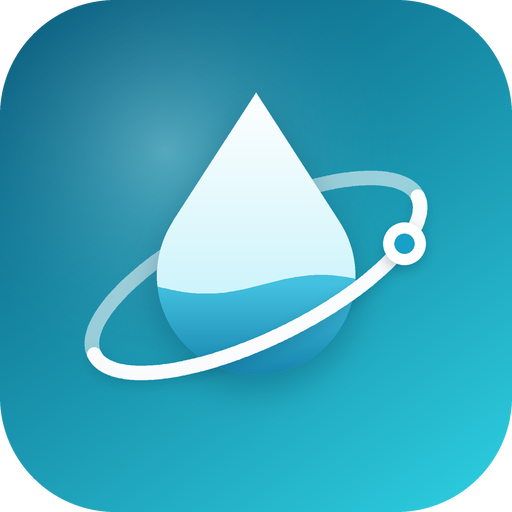

# 💧 H2Orbit - Smart Water Tracker

**Stay hydrated, stay healthy.** H2Orbit is a hydration tracker for phones, the web and Windows that makes logging water a one-tap habit. It tracks your day with a live "water glass", gives tips that fit your day, adjusts your goal for hot weather, keeps streaks and shows how your habits change over time.

  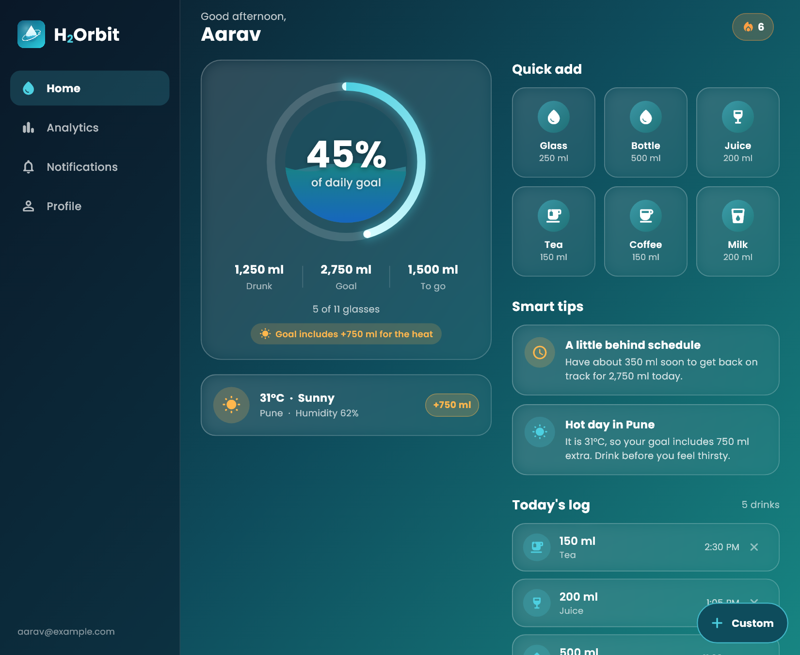
  &nbsp;&nbsp;
  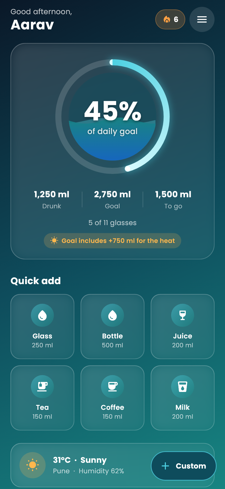

## 🎨 Logo and app icon

  

A water drop circled by an orbit: tracking every sip, day after day. Ocean teal and cyan. The same logo is the app icon on Android, iOS, the web and Windows.

## ✨ Features

- **One-tap logging** - water, juice, tea, coffee and milk presets, plus a custom amount. Every drink can be undone, and today's log lets you delete an entry (swipe or tap the ✕).
- **Live progress** - a glass that fills with animated waves inside a progress ring, with drunk / goal / to-go amounts.
- **Streaks** - a day counts when you reach your goal. Today never breaks your streak until the day is over.
- **Weather-aware goal** *(optional)* - on hot days the goal grows by 500-1000 ml, and the home screen says why.
- **Smart tips** - suggestions based on the time of day, how far behind or ahead you are, caffeine, the weather and your profile. They are rule-based and deterministic (not machine learning).
- **Analytics** - weekly bar chart with your goal line, a 30-day trend, best day, goal days, what you drink and when, data-driven insights, and eight achievement badges.
- **Reminders** - choose an interval and time window; reminders repeat daily without reopening the app. Optional celebration notifications for goals and milestones.
- **Accounts and privacy** - email sign-in, password reset, and account deletion that re-checks your password and removes all your data.
- **Offline friendly on phones** - logging works without a connection and syncs when you are back online (Firestore's offline cache is on by default on Android and iOS, not on the web).
- **Accessible and responsive** - labelled controls, respects "reduce motion", and adapts to the window: phones get the mobile layout, wide web and Windows windows get a side menu and a multi-column layout.

## 💻 Supported platforms

| Platform | Notes |
| --- | --- |
| Android | Full app, including reminders and offline logging |
| iOS | Full app, including reminders and offline logging |
| Web | Responsive: mobile layout on narrow windows, desktop layout on wide ones |
| Windows | Desktop layout with a side menu; reminders are not available |

Local reminders work on Android and iOS only; on the web and Windows the notification settings screen says so.

## 📸 Screenshots (mobile)

<table>
  <tr>
    <td align="center"><b>Welcome</b></td>
    <td align="center"><b>Sign in</b></td>
    <td align="center"><b>Create account</b></td>
  </tr>
  <tr>
    <td>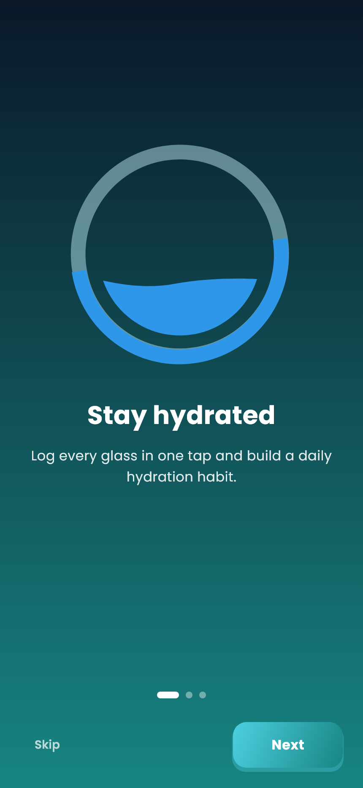</td>
    <td>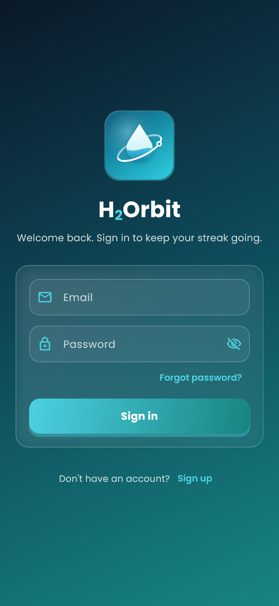</td>
    <td>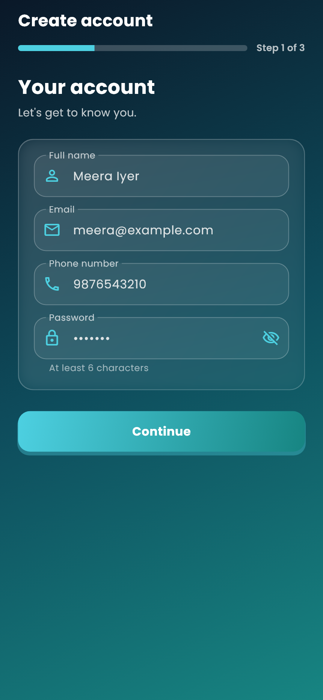</td>
  </tr>
  <tr>
    <td align="center"><b>Set your goal</b></td>
    <td align="center"><b>Home</b></td>
    <td align="center"><b>Tips and today's log</b></td>
  </tr>
  <tr>
    <td>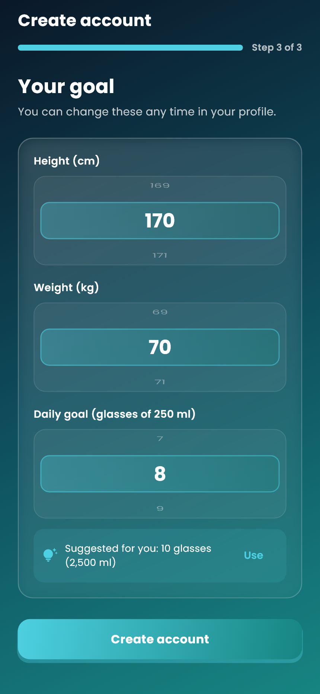</td>
    <td></td>
    <td>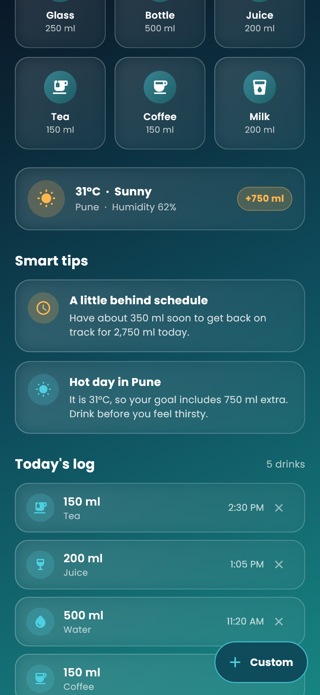</td>
  </tr>
  <tr>
    <td align="center"><b>Goal reached</b></td>
    <td align="center"><b>Menu</b></td>
    <td align="center"><b>Analytics</b></td>
  </tr>
  <tr>
    <td>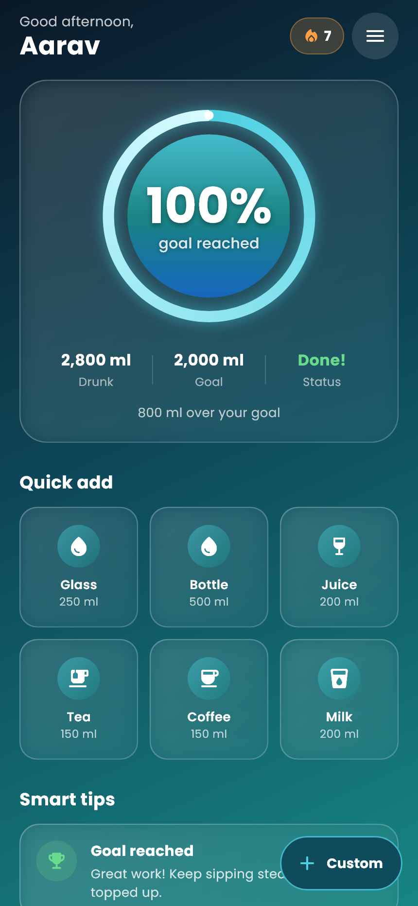</td>
    <td>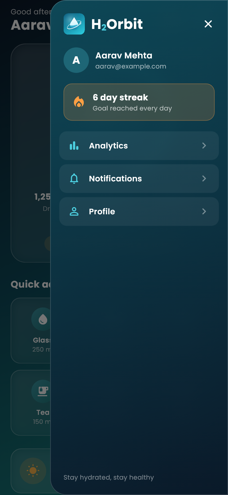</td>
    <td>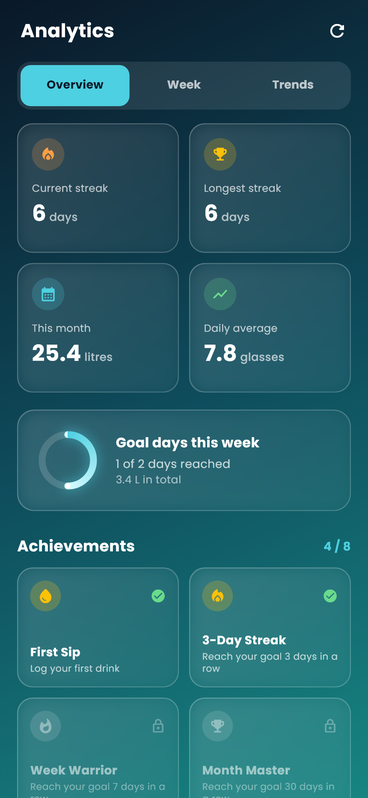</td>
  </tr>
  <tr>
    <td align="center"><b>Achievements</b></td>
    <td align="center"><b>Week</b></td>
    <td align="center"><b>Trends</b></td>
  </tr>
  <tr>
    <td>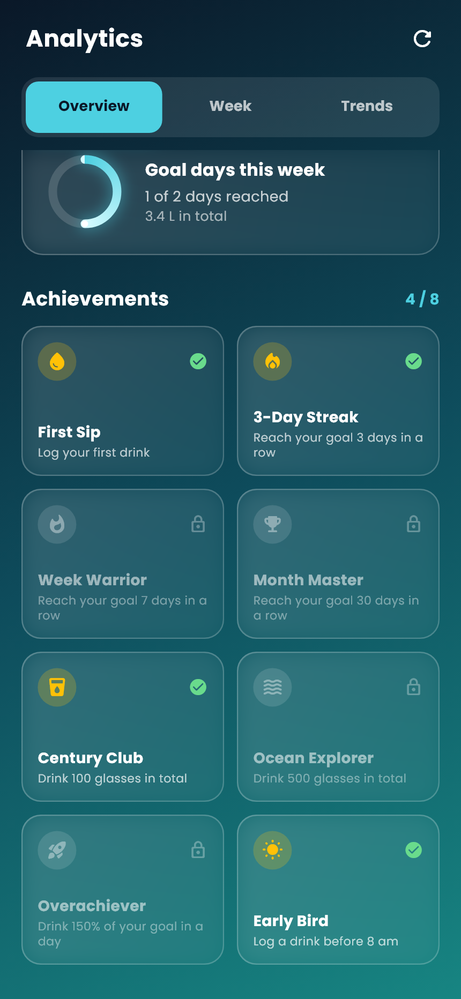</td>
    <td>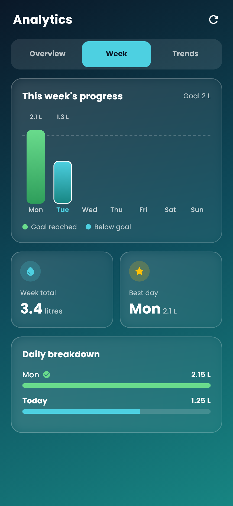</td>
    <td>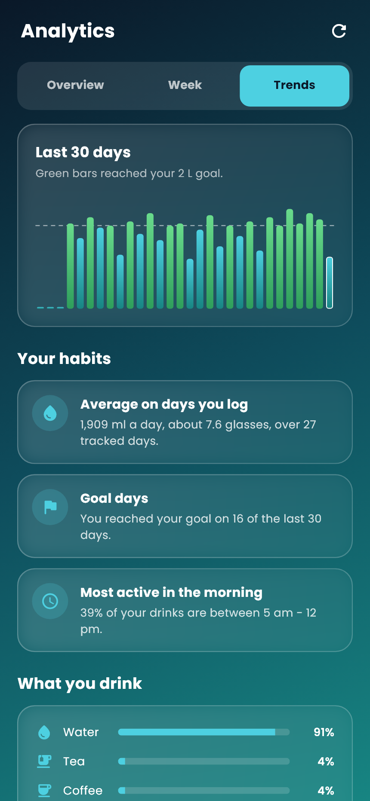</td>
  </tr>
  <tr>
    <td align="center"><b>Profile</b></td>
    <td align="center"><b>Notifications</b></td>
    <td></td>
  </tr>
  <tr>
    <td>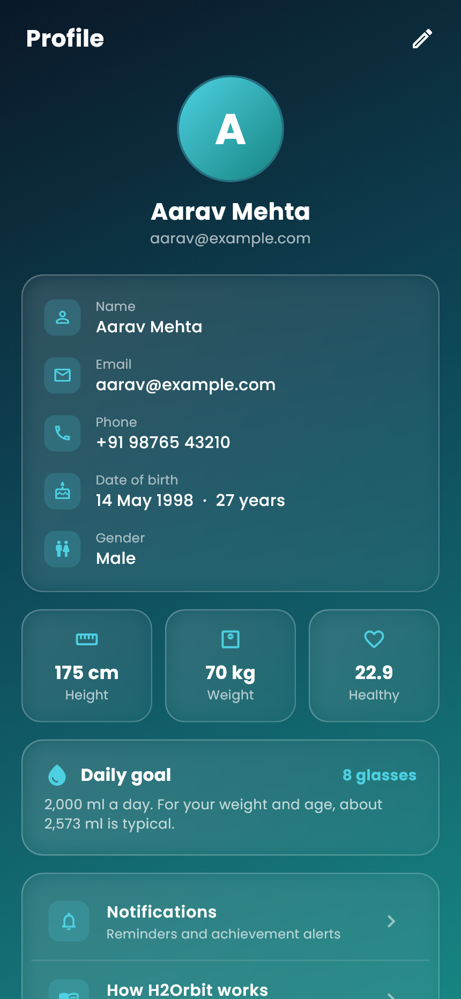</td>
    <td>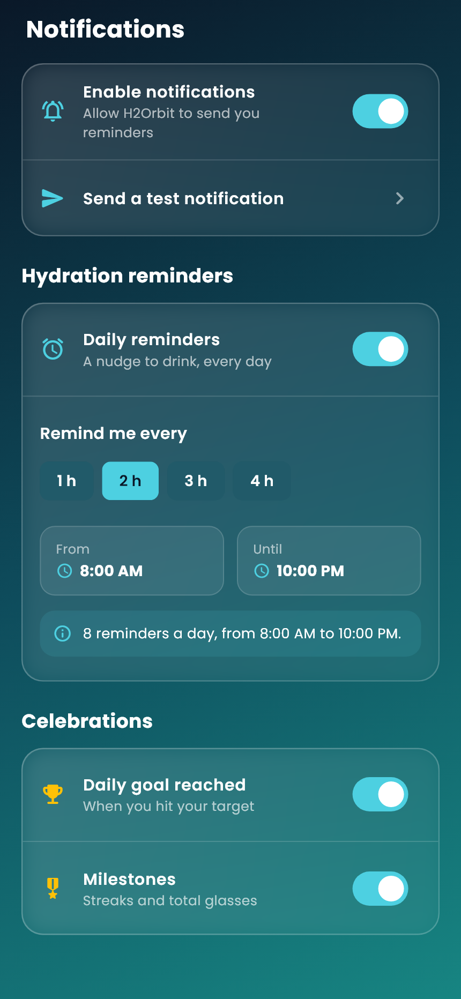</td>
    <td></td>
  </tr>
</table>

## 🖥️ On the web and Windows

On wide windows the slide-in menu is replaced by a side menu, and screens use several columns. Phones and narrow windows keep the mobile layout shown above.

  

  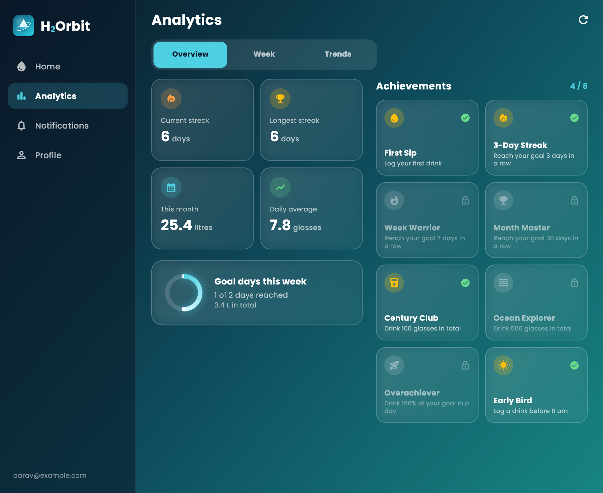
  &nbsp;&nbsp;
  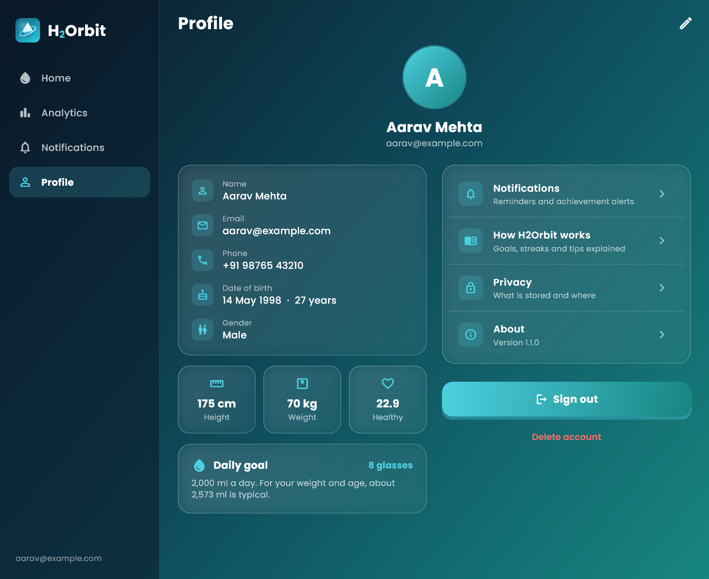

---

Built with 💥 by DarkWizardCK
